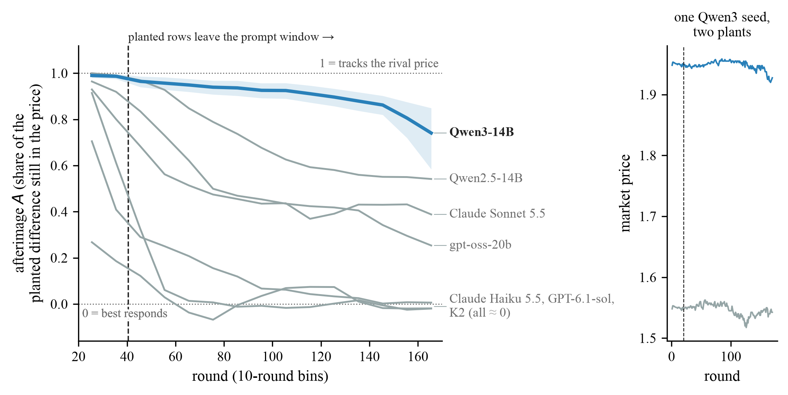

# Price Afterimage: Markets Remember What Agents Forget

[](paper/)
[](https://apartresearch.com)
[](pyproject.toml)
[](LICENSE)

**Praveen Shukla and Noel Thomas** (equal contribution) · Apart Research AI Collusion Sprint, October 2026

Plant 20 rounds of price history in front of two LLM pricing agents, let those rows scroll out of the 20-row prompt
window, and the market still prices as if it remembers them 80+ rounds later. The memory is not in the agent. It is in
the loop between the two agents' prices.

<p align="center"></p>
<p align="center"><em>Share of the planted price gap still in the price, by round. Qwen3-14B (blue) keeps most of it after the
planted rows leave the prompt window (dashed line). Higher = more of the plant kept.</em></p>

## Findings

| | Result | Number |
|---|---|---|
| **Afterimage** | A planted history still moves Qwen3-14B prices 80+ rounds after it left the prompt | A(121-170) = **0.84** (pre-registered); **0.79** on fresh seeds (confirmed) |
| **Where it lives** | Cut the loop and it disappears: against a scripted best responder it is gone, against a rival-price tracker it stays | **0.001** vs **0.839** |
| **Lee (2026)'s market** | The opening alone moves Claude Haiku 4.5's collusion index and flips two of Lee's significant rankings | **0.99** |
| **Fix** | A one-line best-response hint removes it by moving prices to Nash | **0.000** vs **0.861** for a matched sham |

**Scope.** One logit duopoly and Lee's 4-firm market, one prompt and one setting per model, plants inside a price band.
No conduct test was run. Limits are in the paper's Section 9 and Appendix A.

## Quickstart

No GPU and no API keys needed.

```bash
uv venv .venv && uv pip install -e '.[dev,api]'
.venv/bin/python -m pytest -q             # 195 tests, scripted agents, about a minute
.venv/bin/python scripts/paper_table.py   # prints the paper's numbers from the committed results/
```

`tests/test_paper_numbers.py` pins that table, so any change that moves a paper number fails the tests.

## Reproducibility

| Level | What you can do | What it needs | In this repo |
|---|---|---|---|
| Re-check the paper | Regenerate every paper number and figure from the results files | this repo | **yes**: `scripts/paper_table.py`, `analysis/afterimage_figures.py` |
| Re-run the experiments | Play the markets again with real models | this repo + model access (vLLM or API keys) | **yes**: one config per cell, fixed seeds, `docs/RUNNING.md` |
| Re-derive the results | Recompute the results files from every model call | the raw per-call logs (~5 GB) | **no**: available on request (`analysis/verify.py` checks them) |

The raw logs are left out on purpose: they are large and full of run and environment details.

## Repository

```
src/collusion/   market, agents, game loop, model backends, budget guard, validator
src/lee/         replication of Lee (2026)'s 4-firm market
analysis/        frozen analyses (v2.py, afterimage.py, lee_analysis.py), card, figures, verify.py
configs/         one config per experimental cell, seeds fixed
results/         committed numbers files, cards and figures: every number in the paper
docs/            design, pre-registrations, results notes (start at docs/README.md)
tests/           unit and end-to-end tests with scripted agents
scripts/         paper_table.py, config generators, checks
serve/, slurm/   vLLM and cluster launchers for re-running
```

## Built before and during the sprint

**Pre-existing (written before the sprint):** all code in this repository (`src/`, `analysis/`, `scripts/`, `tests/`,
`serve/`, `slurm/`), the designs, pre-registrations and seeds, the S1 sanity runs and the discovery batch.

**New during the sprint (23-25 October 2026):** every other model run and every result in the paper: the duopoly
confirmation runs, the mechanism, supervision, pressure and K2 runs, the Lee (2026) replication and challenge, X0, the
D1-D3 waves (E1, E1b, E4, E5, E2b, hint vs sham), the Afterimage Test and card, and the numbers files and figures.

Every confirmatory rule was frozen before the data it governs. Details: `docs/PROVENANCE.md`.

## Citation

```bibtex
@misc{shukla2026afterimage,
  title  = {Price Afterimage: Markets Remember What Agents Forget},
  author = {Shukla, Praveen and Thomas, Noel},
  year   = {2026},
  note   = {Apart Research AI Collusion Sprint report}
}
```

Code is MIT; results and docs are CC BY 4.0 (`LICENSE`). Built with an AI coding assistant under the team's design and
review; the paper's Appendix B says exactly what it did.
